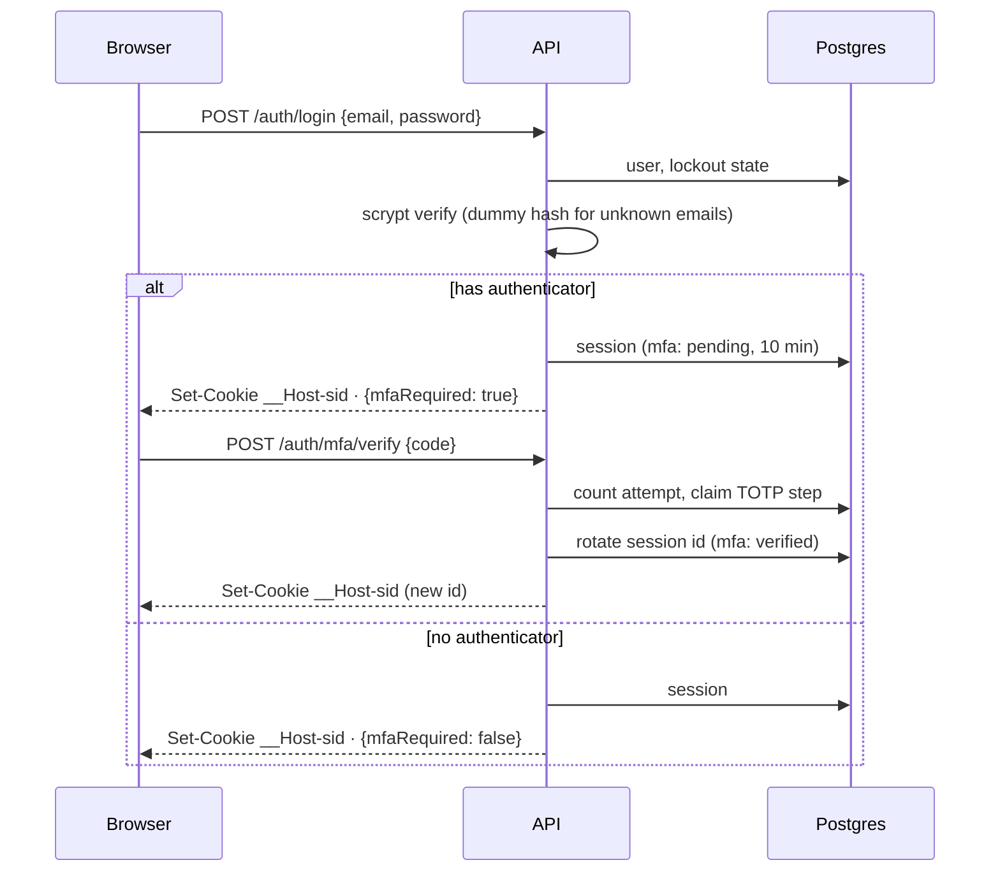
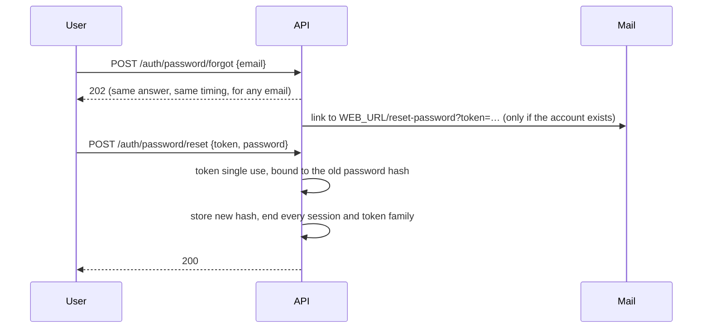
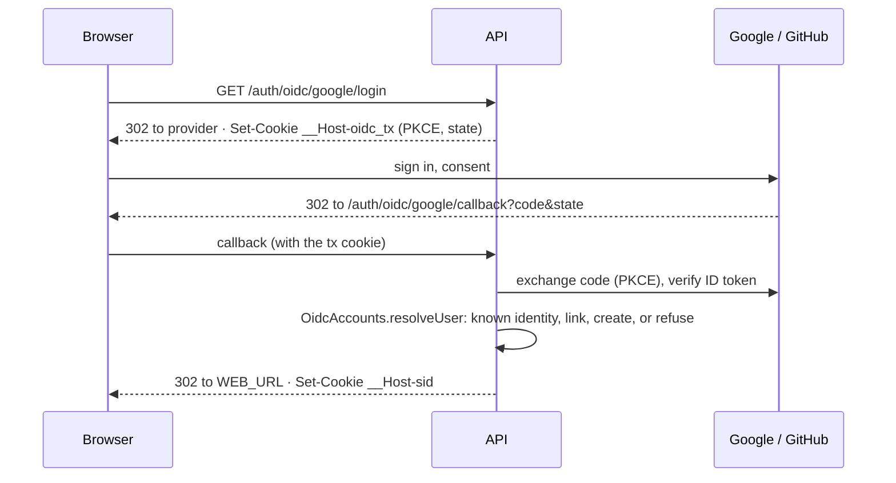

# Architecture

## The split

[`@nestjs/authentication`](https://docs.nestjs.com/security/authentication) and
[`@nestjs/authorization`](https://docs.nestjs.com/security/authorization) own
the protocols: token formats, rotation, TOTP math, link binding, OIDC, the
guards. They don't touch your database, send email, or know what a user is.
This repo provides those parts:

| Package expects | This repo provides |
| --- | --- |
| Six storage contracts | `PrismaAuthenticationStore`, one Postgres table per contract |
| Credential providers | `SessionAuthProvider`, `JwtAuthProvider`, `ApiKeyAuthProvider` |
| Feature handlers | `PasswordResetMailer`, `EmailVerificationMailer`, `MagicLinkMailer`, `OidcAccounts` |
| Policies | `UserPolicy` |
| Everything else | Passkeys, login lockout, audit trail, admin user management, mail, rate limiting, problem details |

## Layout

```
src/
  main.ts                 bootstrap
  app.module.ts           module graph (auth before authorization)
  app.setup.ts            prefix, CORS, security headers, CSRF, validation, /docs
  config/env.ts           the one zod schema for every setting
  auth/
    auth.module.ts        registers only the enabled features
    auth.options.ts       env → @nestjs/authentication options
    auth.types.ts         AuthUser and the AuthenticationTypes augmentation
    stores/               Prisma storage for all six contracts
    providers/            session cookie, JWT bearer, API key
    handlers/             mail-sending handlers, OIDC account linking
    controllers/          sign-in, tokens, MFA, magic links, OIDC
    passkeys/             WebAuthn
    api-keys/             personal API keys
    login.service.ts      credential check and account lockout
    passwords.service.ts  scrypt, plus bcrypt for accounts from v1
  users/                  profile, admin routes, UserPolicy
  audit/                  audit trail (subscribes to AuthenticationEvents)
  health/                 readiness and liveness probes
  infra/                  database, mail, logging, Redis rate-limit storage
  common/                 problem details filter, pagination, helpers
```

## Request pipeline

1. **CSRF check** (`app.enableCsrfProtection`): state-changing requests that the
   browser marks cross-origin are refused unless the origin is in `CORS_ORIGIN`.
2. **Rate limit** (`ThrottlerGuard`): 120 requests a minute per client by
   default, tighter on sign-in routes.
3. **Authentication** (`AuthenticationGuard`): providers run in order: session
   cookie, JWT bearer, API key. The first that recognises its credentials
   decides. Routes are private unless marked `@Public()`.
4. **Authorization** (`AuthorizationGuard`): every route needs `@Can(...)`,
   `@Can.Anyone()` or `@Public()`; anything else is denied.
5. **Validation** (`ValidationPipe`): unknown fields are rejected.
6. **Errors** (`ProblemDetailsFilter`): RFC 9457 bodies; internal errors are
   logged with the request id and never echoed.

## Flows

### Browser sign-in, with 2FA



### Token clients and refresh rotation

```mermaid
sequenceDiagram
  participant C as Mobile app
  participant A as API
  participant DB as Postgres
  C->>A: POST /auth/token {email, password, code?}
  A-->>C: accessToken (15 min JWT) + refreshToken (opaque)
  C->>A: GET /users/me  Authorization: Bearer …
  C->>A: POST /auth/token/refresh {refreshToken: R1}
  A->>DB: mark R1 used (conditional write)
  A-->>C: new pair with R2 (same family)
  Note over C,A: An attacker replays R1
  C->>A: POST /auth/token/refresh {refreshToken: R1}
  A->>DB: R1 already used → revoke the family
  A-->>C: 401; R2 is dead too, the user signs in again
```

### Password reset



### Signing in with Google or GitHub



Account linking rules (`src/auth/handlers/oidc-accounts.resolver.ts`):
an identity is linked to an existing account by email only when the provider
verified the email *and* the account verified it too. Otherwise someone who
registered your address first could keep access after you sign in with Google.

## Storage

Each storage contract has a table, and the methods that guard against races
are single statements:

| Contract | Table | Atomic operations |
| --- | --- | --- |
| sessions | `sessions` | conditional touch, delete with row count |
| refreshTokens | `refresh_tokens`, `refresh_token_family_revocations` | `UPDATE … WHERE used_at IS NULL` |
| mfa | `totp_credentials`, `recovery_codes`, `mfa_failures` | `GREATEST()` upsert, conditional step claim, delete-one recovery code |
| emailTokens | `email_tokens` | `DELETE … RETURNING` |
| magicLinks | `magic_links` | `DELETE … RETURNING` |
| oidcStates | `oidc_states` | `DELETE … RETURNING` |

`test/stores.e2e-spec.ts` runs the package's `authenticationStoreContract()`
suite against the store, with `concurrent: true`, so the race cases run
against real Postgres connections.
